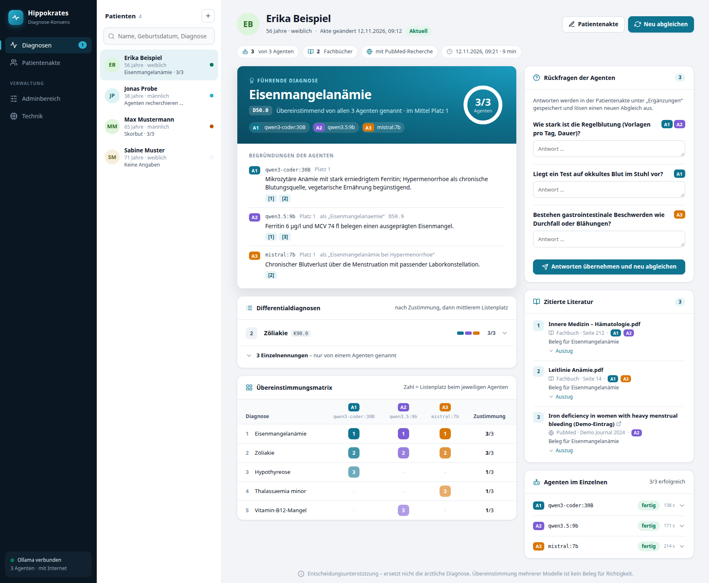
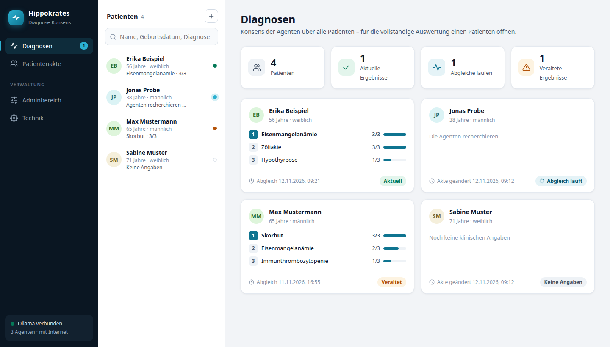
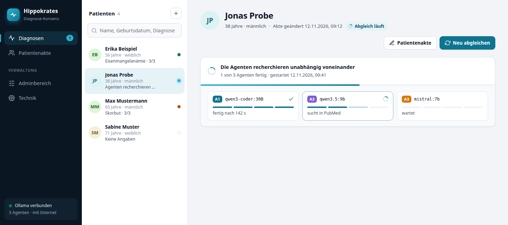
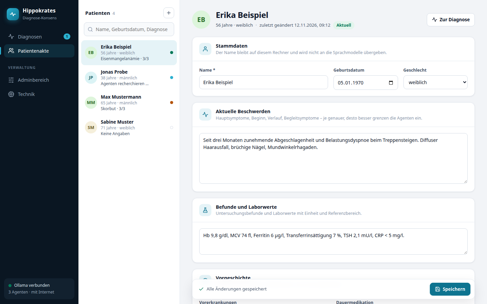
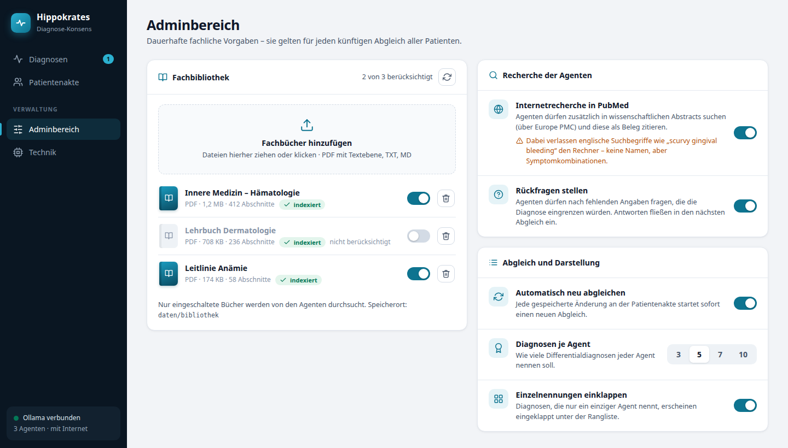
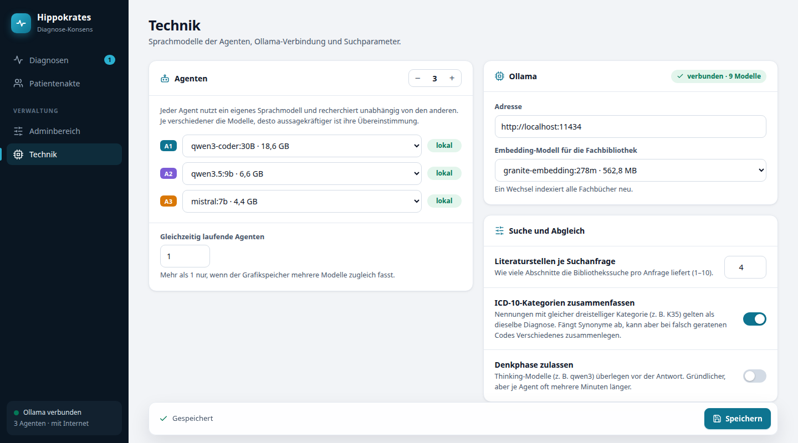
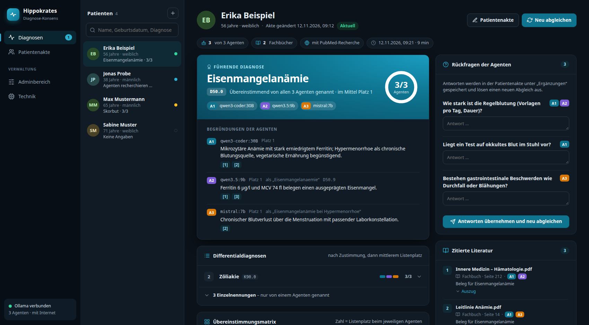

# Hippokrates

**Lokales Werkzeug zur Diagnoseunterstützung: Mehrere KI-Agenten mit unterschiedlichen Sprachmodellen recherchieren unabhängig voneinander in medizinischer Fachliteratur – ein deterministischer Abgleich ordnet ihre Diagnosen danach, wie viele Agenten übereinstimmen.**



> **Hinweis:** Hippokrates dient ausschließlich der Entscheidungsunterstützung für medizinisches Fachpersonal. Es ersetzt weder die ärztliche Diagnose noch die Behandlungsentscheidung. Dass mehrere Modelle übereinstimmen, ist kein Beleg dafür, dass sie richtig liegen.

---

## Die Idee

Ein einzelnes Sprachmodell liefert eine plausibel klingende Antwort, aber ob sie belastbar ist, lässt sich schwer einschätzen. Hippokrates fragt deshalb mehrere Modelle **unabhängig voneinander** und macht sichtbar, wo sie übereinstimmen:

1. In der **Patientenakte** werden Beschwerden, Befunde und Vorgeschichte erfasst und dauerhaft lokal gespeichert.
2. Jede gespeicherte Änderung startet sofort einen **Abgleich**. Dafür arbeitet eine festgelegte Zahl von Agenten, jeder mit einem eigenen Sprachmodell.
3. Jeder Agent **recherchiert selbst**: Er formuliert Suchanfragen, durchsucht die lokale Fachbibliothek (RAG) und – falls erlaubt – PubMed. Danach nennt er seine Differentialdiagnosen mit ICD-10-Code, Begründung und Belegstellen. Die Agenten sehen einander nicht.
4. Ein **deterministischer Abgleich** ohne Sprachmodell führt gleiche Diagnosen zusammen und sortiert sie: Was mehr Agenten nennen, steht weiter oben. Gleiche Eingaben ergeben immer dieselbe Rangfolge.
5. Fehlen wichtige Angaben, stellen die Agenten **Rückfragen**. Die Antworten fließen in die Akte und lösen den nächsten Abgleich aus.

Alles läuft lokal über [Ollama](https://ollama.com). Patientennamen werden nie an ein Sprachmodell übergeben.

---

## Die Oberfläche

### Diagnosen

Die Übersicht zeigt alle Patienten mit Abgleichstatus und den drei führenden Diagnosen samt Zustimmung.



Pro Patient (Bild oben):

- **Führende Diagnose** mit Zustimmungsring („3/3 Agenten“) und den Begründungen jedes Agenten
- **Differentialdiagnosen** mit Zustimmungsbalken; Diagnosen, die nur ein Agent nennt, sind eingeklappt
- **Übereinstimmungsmatrix**: welcher Agent welche Diagnose auf welchem Platz genannt hat
- **Zitierte Literatur**: Fachbuchstellen mit Seite und PubMed-Abstracts mit Link; ein Klick auf [1] springt zur Quelle
- **Rückfragen** der Agenten mit Antwortfeldern
- **Rahmen** des Abgleichs: beteiligte Modelle, berücksichtigte Fachbücher, Internetrecherche, Zeitpunkt und Dauer

Während ein Abgleich läuft, zeigt jede Agentenkachel ihren aktuellen Schritt. Das letzte abgeschlossene Ergebnis bleibt bis dahin sichtbar.



### Patientenakte

Die Akte ist gegliedert in Stammdaten, aktuelle Beschwerden, Befunde und Laborwerte, Vorgeschichte, Familie und Lebensumstände sowie Ergänzungen (dort landen auch die Antworten auf Rückfragen). Ungespeicherte Änderungen werden angezeigt; Strg+S speichert.



### Adminbereich

Hier liegen dauerhafte **fachliche** Vorgaben, die für alle künftigen Abgleiche gelten:

- welche Fachbücher der Bibliothek berücksichtigt werden (Upload per Drag & Drop, Schalter je Buch)
- Internetrecherche in PubMed ja/nein
- Rückfragen ja/nein
- automatischer Abgleich bei Änderungen ja/nein
- Anzahl der Diagnosen je Agent
- Einzelnennungen einklappen



### Technik

Technische Einstellungen: Anzahl der Agenten und ihre Sprachmodelle, Ollama-Adresse, Embedding-Modell für die Bibliothek, Literaturstellen je Suchanfrage, Zusammenfassung nach ICD-10-Kategorie und Denkphase für Thinking-Modelle. Cloud-Modelle werden gekennzeichnet; vor ihrer Verwendung mit Patientendaten wird gewarnt.



Die Oberfläche passt sich dem hellen oder dunklen Farbschema des Systems an.



---

## So funktioniert der Abgleich

```
Patientenakte ──(Änderung gespeichert)──▶ Abgleich startet
                                              │
             ┌────────────────────────────────┼────────────────────────────────┐
             ▼                                ▼                                ▼
     Agent 1 (Modell A)               Agent 2 (Modell B)               Agent N (Modell N)
     plant Recherche                  plant Recherche                  plant Recherche
     durchsucht Fachbücher            durchsucht Fachbücher            durchsucht Fachbücher
     sucht in PubMed (optional)       sucht in PubMed (optional)       sucht in PubMed (optional)
     nennt Diagnosen + Rückfragen     nennt Diagnosen + Rückfragen     nennt Diagnosen + Rückfragen
             └────────────────────────────────┼────────────────────────────────┘
                                              ▼
                          deterministischer Konsens (konsens.py)
                                              ▼
                             Rangliste in der Diagnoseansicht
```

**Wann gelten zwei Nennungen als dieselbe Diagnose?**

- Wenn ihre Namen nach dem Normalisieren übereinstimmen. Dabei werden Groß- und Kleinschreibung, Umlaute, c/k/z-Schreibweisen (Appendicitis = Appendizitis), Klammerzusätze, „V. a.“, Füllwörter, Wortreihenfolge und römische Typziffern angeglichen.
- Oder wenn ihre ICD-10-Codes in derselben dreistelligen Kategorie liegen (zum Beispiel D50.0 und D50.9). Das ist abschaltbar, weil kleine Modelle Codes manchmal falsch raten.

**Rangfolge:** zuerst die Zahl der zustimmenden Agenten, bei Gleichstand der mittlere Listenplatz, danach alphabetisch. Jeder Agent zählt je Diagnose nur einmal.

**Robustheit:** Fällt ein Agent aus (Zeitlimit, ungültige Antwort), läuft der Abgleich mit den übrigen weiter, und der Ausfall wird angezeigt. Wird die Akte während eines laufenden Abgleichs erneut geändert, ersetzt ein neuer Abgleich den alten. Jedes Modell darf nur einem Agenten zugewiesen werden, damit es sich nicht selbst zustimmt.

---

## Datenschutz

- Patientendaten, Fachbibliothek und Suchindex liegen in einer lokalen SQLite-Datenbank im Ordner `daten/`. Er ist per `.gitignore` vom Repository ausgeschlossen.
- Der Patientenname wird nie an ein Sprachmodell übergeben; die Agenten sehen nur Alter, Geschlecht und die klinischen Angaben.
- Der Server ist nur vom eigenen Rechner erreichbar (`127.0.0.1`). Eine Benutzeranmeldung gibt es noch nicht.
- **Ausnahmen, die Daten nach außen geben:**
  - die PubMed-Recherche (im Adminbereich standardmäßig aus): Dabei gehen die von den Agenten formulierten englischen Suchbegriffe an [Europe PMC] – keine Namen, aber Symptomkombinationen;
  - als Agent gewählte Ollama-Cloud-Modelle: Sie erhalten die vollständigen klinischen Angaben. Die Oberfläche kennzeichnet sie und warnt davor.

[Europe PMC]: https://europepmc.org

---

## Installation

Voraussetzungen:

- Python 3.12 oder neuer
- ein laufendes [Ollama](https://ollama.com) mit mindestens zwei verschiedenen Chat-Modellen und einem Embedding-Modell, zum Beispiel:

```bash
ollama pull mistral:7b
ollama pull qwen3.5:9b
ollama pull granite-embedding:278m
```

Installieren und starten:

```bash
git clone https://github.com/Christian-Alexander141/Hippokrates.git
cd Hippokrates
python3 -m venv .venv
.venv/bin/pip install -r requirements.txt
.venv/bin/python src/main.py
```

Die Anwendung läuft dann unter <http://127.0.0.1:8000>. Beim ersten Start werden die drei größten lokalen Chat-Modelle als Agenten und das erste Embedding-Modell vorbelegt.

**Erste Schritte**

1. Unter **Technik** die Agenten und ihre Modelle prüfen.
2. Im **Adminbereich** Fachbücher hochladen (PDF mit Textebene, TXT oder MD). Sie werden lokal indexiert.
3. In der **Patientenakte** einen Patienten anlegen und speichern. Der erste Abgleich startet automatisch.

Den Speicherort der Daten legt die Umgebungsvariable `HIPPOKRATES_DATEN` fest (Standard: `daten/` im Projektordner).

**Hardware:** Mit `Gleichzeitig laufende Agenten = 1` arbeiten die Agenten nacheinander, sodass jeweils nur ein Modell im Grafikspeicher liegt. Auf einer Grafikkarte mit 11 GB dauert ein Abgleich mit drei kleineren Modellen (2 bis 7 Milliarden Parameter) einige Minuten.

**Tests:** `.venv/bin/python -m unittest discover tests`

---

## Technik und Projektstruktur

| Schicht | Technologie |
|---|---|
| Backend | Python · FastAPI |
| Speicherung | SQLite (Patienten, Einstellungen, Abgleiche, Literaturindex) |
| Sprachmodelle und Embeddings | Ollama |
| RAG | eigene Indexierung (pypdf) und Kosinussuche (NumPy) |
| Internetrecherche | Europe-PMC-REST-Schnittstelle (PubMed-Abstracts) |
| Oberfläche | eine HTML-Seite ohne Build-Schritt und ohne externe Abhängigkeiten |

```
Hippokrates/
├── src/
│   ├── main.py                  # FastAPI-Server und API-Routen
│   ├── Index/index.html         # Oberfläche (Diagnosen, Patientenakte, Adminbereich, Technik)
│   └── model/Datenkern/
│       ├── db.py                # SQLite-Speicherung und Einstellungen
│       ├── ollama.py            # Ollama-Client (JSON-Schema, Zeitlimit, Abbruch)
│       ├── rag.py               # Fachbibliothek: Indexierung und Suche
│       ├── web.py               # optionale PubMed-Recherche
│       ├── agent.py             # ein recherchierender Diagnose-Agent
│       ├── abgleich.py          # startet die Agenten, reagiert auf Datenänderungen
│       └── konsens.py           # deterministischer Vergleich und Rangfolge
├── tests/                       # Tests für den Konsens
├── docs/bilder/                 # Screenshots (Demo-Daten)
└── daten/                       # Laufzeitdaten (nicht im Repository)
```

---

## Stand und Ausblick

| Komponente | Status |
|---|---|
| Patientenakte mit dauerhafter lokaler Speicherung | ✅ umgesetzt |
| Automatischer Abgleich bei jeder Änderung | ✅ umgesetzt |
| Multi-Agenten-Recherche mit verschiedenen Modellen | ✅ umgesetzt |
| Lokale Fachbibliothek (RAG) mit Auswahl der Bücher | ✅ umgesetzt |
| Optionale PubMed-Recherche | ✅ umgesetzt |
| Rückfragen der Agenten mit Antworten in der Akte | ✅ umgesetzt |
| Deterministischer Konsens und Diagnoseansicht | ✅ umgesetzt |
| Dokumente und strukturierte Laborwerte je Patient | 📋 geplant |
| Verlaufsgrafiken für Laborwerte (Entwurf: `src/Index/mediconsult.html`) | 📋 geplant |
| Benutzerrollen und Audit-Log | 📋 geplant |
| Gegenseitige Prüfung der Agenten (Peer-Review) | 📋 geplant |

Die Bilder in dieser README zeigen erfundene Demo-Patienten; die Abgleiche darin wurden für die Aufnahmen direkt in die Datenbank geschrieben.

---

## Lizenz

Dieses Projekt steht unter der [GNU General Public License v3.0](LICENSE).
