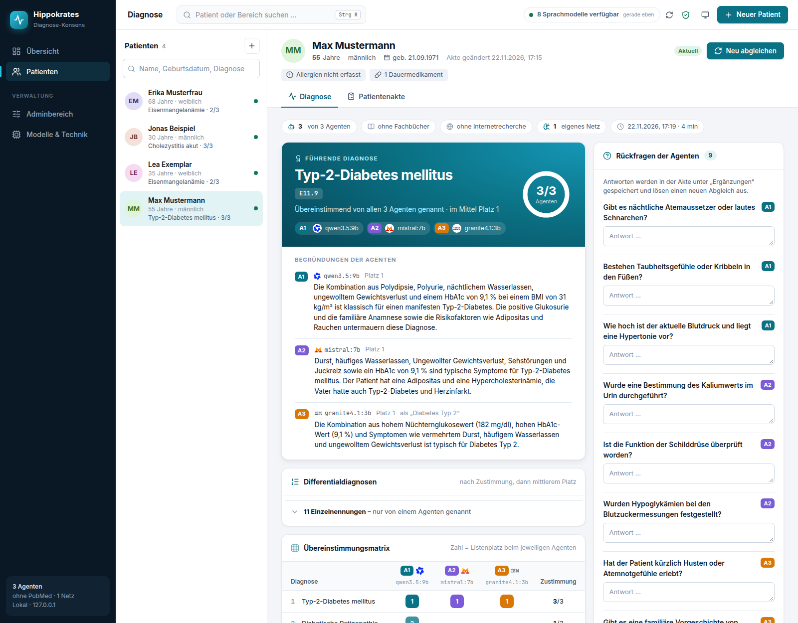
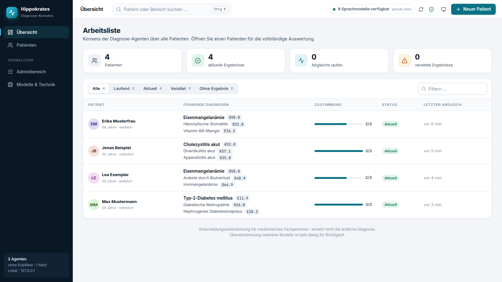
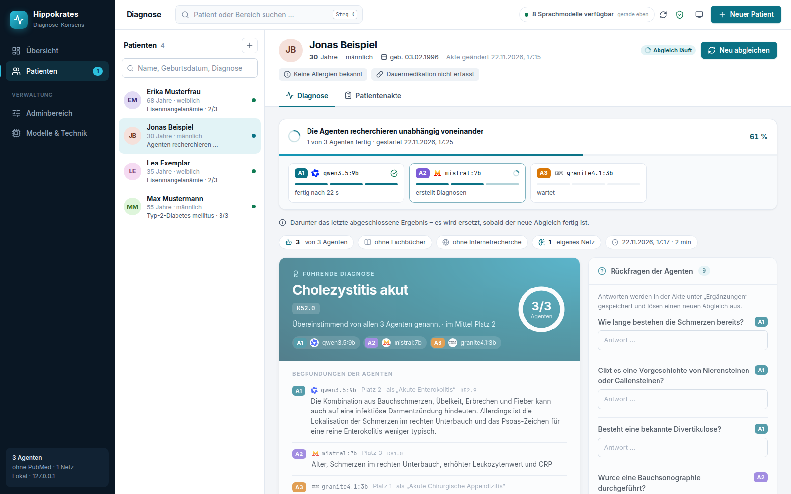
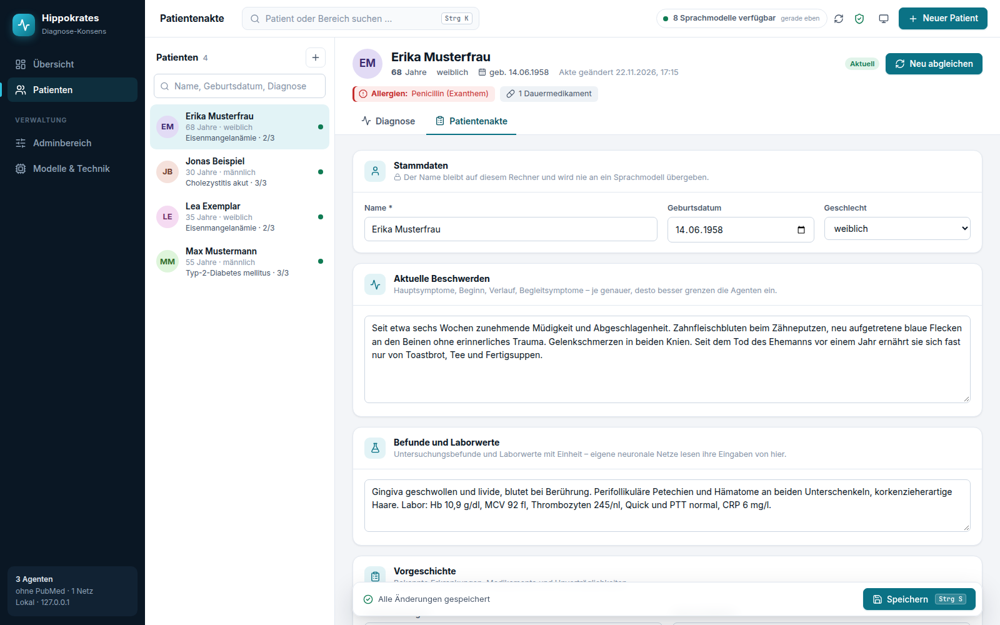
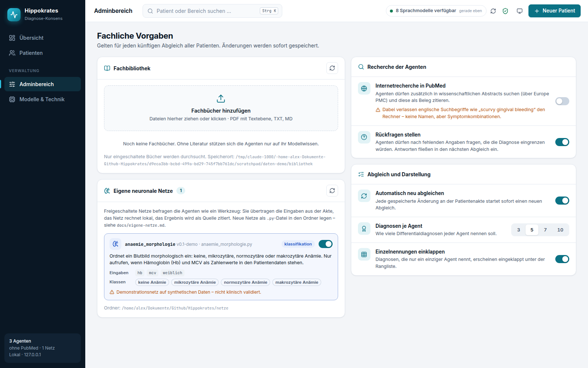
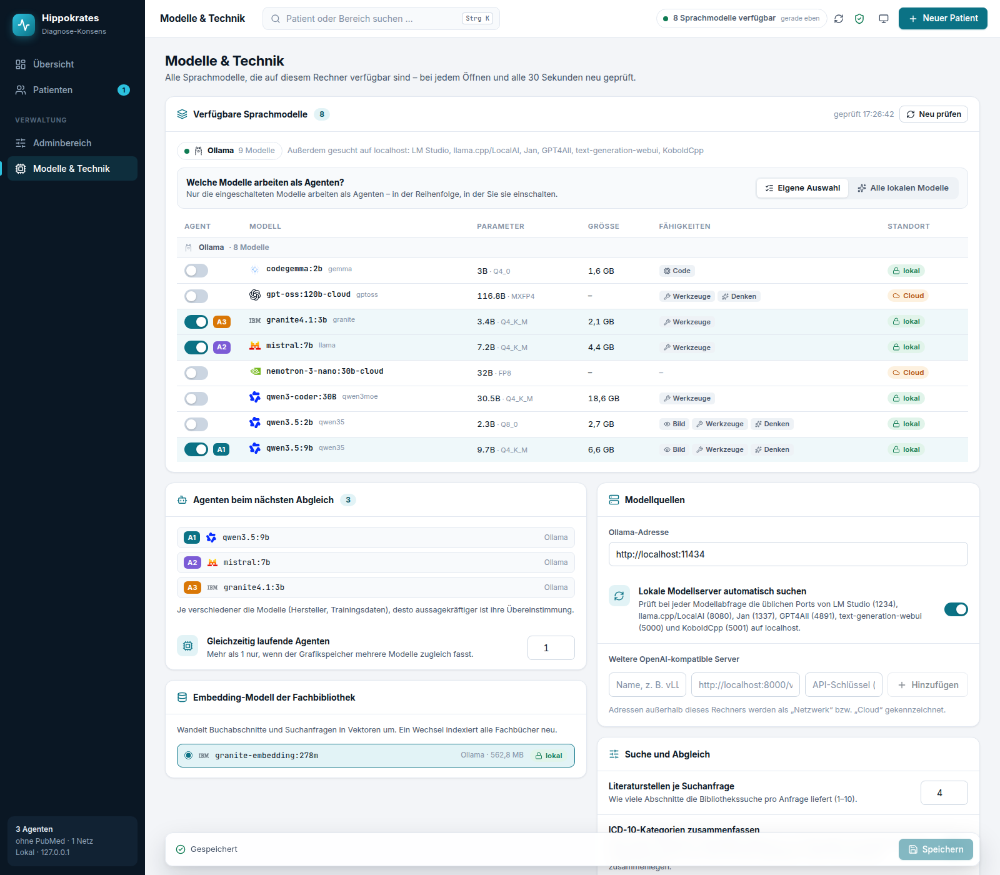
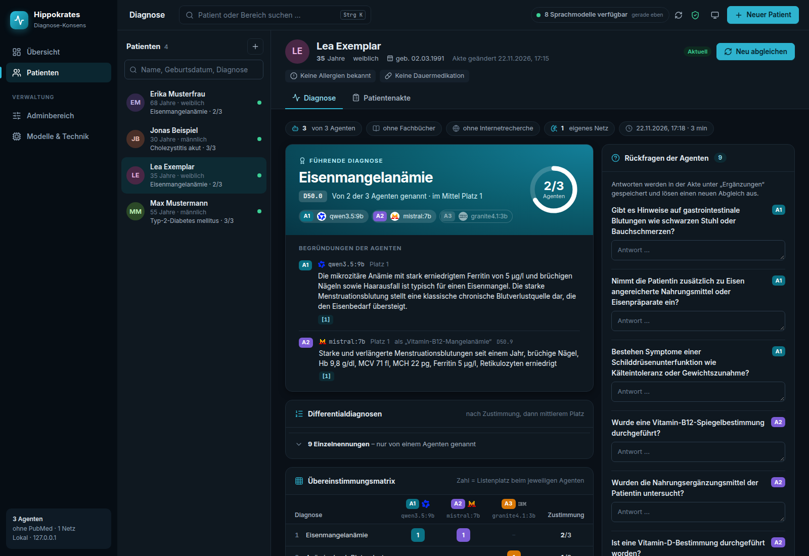

# Hippokrates

**Lokales Werkzeug zur Diagnoseunterstützung: Mehrere KI-Agenten mit unterschiedlichen Sprachmodellen recherchieren unabhängig voneinander in medizinischer Fachliteratur und befragen auf Wunsch eigene neuronale Netze – ein deterministischer Abgleich ordnet ihre Diagnosen danach, wie viele Agenten übereinstimmen.**



> **Hinweis:** Hippokrates dient ausschließlich der Entscheidungsunterstützung für medizinisches Fachpersonal. Es ersetzt weder die ärztliche Diagnose noch die Behandlungsentscheidung. Dass mehrere Modelle übereinstimmen, ist kein Beleg dafür, dass sie richtig liegen.

## Schnellstart

```bash
git clone https://github.com/Christian-Alexander141/Hippokrates.git
cd Hippokrates
./installieren.sh
```

Ein Befehl richtet alles in Docker ein und startet Hippokrates unter <http://127.0.0.1:8000>. Die Sprachmodelle laufen weiter auf dem eigenen Rechner (z. B. [Ollama](https://ollama.com)); fehlen welche, bietet das Skript den Download an. Details unter [Installation](#installation).

---

## Die Idee

Ein einzelnes Sprachmodell liefert eine plausibel klingende Antwort, aber ob sie belastbar ist, lässt sich schwer einschätzen. Hippokrates fragt deshalb mehrere Modelle **unabhängig voneinander** und macht sichtbar, wo sie übereinstimmen:

1. In der **Patientenakte** werden Beschwerden, Befunde und Vorgeschichte erfasst und dauerhaft lokal gespeichert.
2. Jede gespeicherte Änderung startet sofort einen **Abgleich**. Dafür arbeiten mehrere Agenten, jeder mit einem eigenen Sprachmodell – entweder eine feste Auswahl oder **alle lokal verfügbaren Modelle**, die vor jedem Abgleich neu ermittelt werden.
3. Jeder Agent **recherchiert selbst**: Er formuliert Suchanfragen, durchsucht die lokale Fachbibliothek (RAG), auf Wunsch PubMed und überträgt Laborwerte an **eigene neuronale Netze**. Danach nennt er seine Differentialdiagnosen mit ICD-10-Code, Begründung und Belegstellen. Die Agenten sehen einander nicht.
4. Ein **deterministischer Abgleich** ohne Sprachmodell führt gleiche Diagnosen zusammen und sortiert sie: Was mehr Agenten nennen, steht weiter oben. Gleiche Eingaben ergeben immer dieselbe Rangfolge.
5. Fehlen wichtige Angaben, stellen die Agenten **Rückfragen**. Die Antworten fließen in die Akte und lösen den nächsten Abgleich aus.

Alles läuft lokal – mit [Ollama](https://ollama.com) oder jedem anderen lokalen Modellserver. Patientennamen werden nie an ein Sprachmodell übergeben.

---

## Die Oberfläche

Die Oberfläche ist eine React-Anwendung im Stil eines klinischen Arbeitsplatzsystems: Navigationsleiste links, Patientenliste, Patientenkopf mit Allergie- und Medikationshinweis, Reiter für Diagnose und Akte. **Strg+K** öffnet eine Schnellsuche für Patienten, Diagnosen, ICD-10-Codes und Bereiche. Hell- und Dunkelmodus folgen dem System oder lassen sich festlegen. Jedes Modell trägt das **Logo seines Anbieters** (Mistral, Qwen, Z.ai/GLM, Meta, Gemma, IBM Granite, DeepSeek, OpenAI, NVIDIA …).

### Übersicht

Die Arbeitsliste zeigt alle Patienten mit Abgleichstatus, den drei führenden Diagnosen samt ICD-10-Code und der Zustimmung der Agenten. Filter: laufend, aktuell, veraltet, ohne Ergebnis.



### Diagnose

Pro Patient (Bild oben):

- **Führende Diagnose** mit Zustimmungsring („3/3 Agenten“) und den Begründungen jedes Agenten
- **Differentialdiagnosen** mit Zustimmungsbalken; Diagnosen, die nur ein Agent nennt, sind eingeklappt
- **Übereinstimmungsmatrix**: welcher Agent welche Diagnose auf welchem Platz genannt hat
- **Zitierte Quellen**: Fachbuchstellen mit Seite, PubMed-Abstracts mit Link und Ergebnisse eigener Netze mit Wahrscheinlichkeitsbalken; ein Klick auf [1] springt zur Quelle
- **Rückfragen** der Agenten mit Antwortfeldern
- **Rahmen** des Abgleichs: beteiligte Modelle, Fachbücher, Internetrecherche, eigene Netze, Zeitpunkt und Dauer

Während ein Abgleich läuft, zeigt jede Agentenkachel ihren aktuellen Schritt. Das letzte abgeschlossene Ergebnis bleibt bis dahin sichtbar.



### Patientenakte

Gegliedert in Stammdaten, aktuelle Beschwerden, Befunde und Laborwerte, Vorgeschichte, Familie und Lebensumstände sowie Ergänzungen (dort landen auch die Antworten auf Rückfragen). Ungespeicherte Änderungen werden angezeigt und beim Verlassen abgefragt; Strg+S speichert.



### Adminbereich

Dauerhafte **fachliche** Vorgaben für alle künftigen Abgleiche:

- welche Fachbücher der Bibliothek berücksichtigt werden (Upload per Drag & Drop, Schalter je Buch)
- welche **eigenen neuronalen Netze** die Agenten befragen dürfen – mit Beschreibung, Eingaben, Klassen, Version und Hinweis
- Internetrecherche in PubMed, Rückfragen, automatischer Abgleich, Anzahl der Diagnosen je Agent, Einzelnennungen einklappen



### Modelle & Technik

Der **Modellkatalog** zeigt alle Sprachmodelle, die gerade verfügbar sind – mit Anbieter-Logo, Parametern, Quantisierung, Größe, Fähigkeiten (Werkzeuge, Bild, Denken) und Standort (lokal, Netzwerk, Cloud). Eingeschaltete Modelle arbeiten als Agenten. Dazu: Modus „alle lokalen Modelle“, Embedding-Modell der Bibliothek, Modellquellen, gleichzeitig laufende Agenten, Literaturstellen je Suchanfrage, ICD-10-Zusammenfassung und Denkphase für Thinking-Modelle.





---

## Alle lokal verfügbaren Sprachmodelle

Hippokrates fragt **bei jedem Öffnen der Modellauswahl, alle 30 Sekunden und vor jedem Abgleich** neu ab, welche Modelle bereitstehen, und bietet alle zur Auswahl an:

| Quelle | Erkennung |
|---|---|
| **Ollama** | `/api/tags` und `/api/show` – inklusive Fähigkeiten (Chat, Werkzeuge, Bild, Denken, Embedding) |
| **LM Studio, llama.cpp/LocalAI, Jan, GPT4All, text-generation-webui, KoboldCpp** | automatische Suche auf den üblichen Ports (OpenAI-kompatible Schnittstelle `/v1/models`) |
| **weitere Server** (vLLM, ein GPU-Rechner im Netz …) | Adresse unter „Modelle & Technik“ eintragen, optional mit API-Schlüssel |
| **eigene Netze** | ein `NetzChatModell` im Ordner `netze/` erscheint als Quelle „Eigene Netze“ |

**Agentenauswahl:**

- **Eigene Auswahl** – die eingeschalteten Modelle, in der Reihenfolge des Einschaltens. Ist ein Modell beim Abgleich nicht verfügbar, fällt nur dieser Agent sofort mit klarer Meldung aus.
- **Alle lokalen Modelle** – jeder Abgleich verwendet alle Chat-Modelle auf diesem Rechner, die in diesem Moment verfügbar sind; neu installierte Modelle arbeiten automatisch mit, einzelne lassen sich ausschalten. Cloud- und Netzwerkmodelle sind davon ausgenommen.

Modelle anderer Rechner und Cloud-Modelle werden gekennzeichnet; vor ihrer Verwendung mit Patientendaten wird gewarnt.

---

## Eigene neuronale Netze

Selbst geschriebene Netze – PyTorch, ONNX, scikit-learn, Keras oder reiner NumPy-Code – lassen sich in **LangChain-Agenten** (`create_agent`) und in Hippokrates verwenden. Dafür gibt es die Bibliothek [`netzwerkzeug`](pakete/netzwerkzeug):

```python
from netzwerkzeug import als_werkzeug

anaemie = als_werkzeug(mein_netz, name="anaemie_morphologie", eingabe=Blutbild,
                       beschreibung="Ordnet eine Anämie ein. Nur aufrufen, wenn Hb und MCV vorliegen.",
                       klassen=["keine Anämie", "mikrozytär", "normozytär", "makrozytär"])
agent = create_agent(ChatOllama(model="qwen3.5:9b"), tools=[anaemie])
```

Drei Muster: **Netz als Werkzeug** (das Sprachmodell ruft es auf), **NetzMiddleware** (das Netz läuft immer vor dem Agenten) und **NetzChatModell** (ein eigenes generatives Netz ist das Modell des Agenten). In Hippokrates genügt eine `.py`-Datei im Ordner `netze/`; freigeschaltet wird sie im Adminbereich. Mitgeliefert ist ein Beispielnetz (`netze/anaemie_morphologie.py`, ausdrücklich nicht klinisch validiert).

**Konzept und Dokumentation:** [docs/eigene-netze.md](docs/eigene-netze.md)

---

## So funktioniert der Abgleich

```
Patientenakte ──(Änderung gespeichert)──▶ Abgleich startet ──▶ verfügbare Modelle frisch ermitteln
                                              │
             ┌────────────────────────────────┼────────────────────────────────┐
             ▼                                ▼                                ▼
     Agent 1 (Modell A)               Agent 2 (Modell B)               Agent N (Modell N)
     plant Recherche                  plant Recherche                  plant Recherche
     durchsucht Fachbücher            durchsucht Fachbücher            durchsucht Fachbücher
     sucht in PubMed (optional)       sucht in PubMed (optional)       sucht in PubMed (optional)
     befragt eigene Netze (opt.)      befragt eigene Netze (opt.)      befragt eigene Netze (opt.)
     nennt Diagnosen + Rückfragen     nennt Diagnosen + Rückfragen     nennt Diagnosen + Rückfragen
             └────────────────────────────────┼────────────────────────────────┘
                                              ▼
                          deterministischer Konsens (konsens.py)
                                              ▼
                             Rangliste in der Diagnoseansicht
```

**Wann gelten zwei Nennungen als dieselbe Diagnose?**

- Wenn ihre Namen nach dem Normalisieren übereinstimmen. Dabei werden Groß- und Kleinschreibung, Umlaute, c/k/z-Schreibweisen (Appendicitis = Appendizitis), Klammerzusätze, „V. a.“, Füllwörter, Wortreihenfolge und römische Typziffern angeglichen.
- Oder wenn ihre ICD-10-Codes in derselben dreistelligen Kategorie liegen (zum Beispiel D50.0 und D50.9). Das ist abschaltbar, weil kleine Modelle Codes manchmal falsch raten.

**Rangfolge:** zuerst die Zahl der zustimmenden Agenten, bei Gleichstand der mittlere Listenplatz, danach alphabetisch. Jeder Agent zählt je Diagnose nur einmal.

**Robustheit:** Fällt ein Agent aus (Zeitlimit, ungültige Antwort, Modell nicht verfügbar), läuft der Abgleich mit den übrigen weiter, und der Ausfall wird angezeigt. Wird die Akte während eines laufenden Abgleichs erneut geändert, ersetzt ein neuer Abgleich den alten. Jedes Modell darf nur einem Agenten zugewiesen werden, damit es sich nicht selbst zustimmt. Ergebnisse eigener Netze sind gemeinsame Belege, keine zusätzlichen Stimmen.

---

## Datenschutz

- Patientendaten, Fachbibliothek und Suchindex liegen in einer lokalen SQLite-Datenbank im Ordner `daten/`. Er ist per `.gitignore` vom Repository ausgeschlossen.
- Der Patientenname wird nie an ein Sprachmodell übergeben; die Agenten sehen nur Alter, Geschlecht und die klinischen Angaben.
- Eigene neuronale Netze rechnen im Prozess der Anwendung – ohne Netzwerkzugriff.
- Schriften und Anbieter-Logos sind in die Oberfläche eingebaut; der Browser lädt nichts von fremden Servern.
- Der Server ist nur vom eigenen Rechner erreichbar (`127.0.0.1`, auch in Docker). Eine Benutzeranmeldung gibt es noch nicht.
- **Ausnahmen, die Daten nach außen geben:**
  - die PubMed-Recherche (im Adminbereich standardmäßig aus): Dabei gehen die von den Agenten formulierten englischen Suchbegriffe an [Europe PMC] – keine Namen, aber Symptomkombinationen;
  - als Agent gewählte Cloud-Modelle oder Modellserver auf anderen Rechnern: Sie erhalten die vollständigen klinischen Angaben. Die Oberfläche kennzeichnet sie („Cloud“, „Netzwerk“) und warnt davor.

[Europe PMC]: https://europepmc.org

---

## Installation

### Mit Docker (empfohlen)

Voraussetzungen:

- [Docker Engine](https://docs.docker.com/engine/install/) mit Compose-Plugin (ab 2.24) oder [Docker Desktop](https://docs.docker.com/desktop/)
- ein lokaler Modellserver auf dem Rechner selbst, z. B. [Ollama](https://ollama.com) – Hippokrates braucht mindestens zwei verschiedene Chat-Modelle und ein Embedding-Modell

```bash
./installieren.sh
```

Das Skript erledigt in dieser Reihenfolge:

1. Es prüft Docker und Docker Compose und startet Docker bei Bedarf nach Rückfrage.
2. Es wählt die passende Netzvariante: unter Linux mit Docker Engine das Host-Netz (Ollama braucht dann keine Umkonfiguration), mit Docker Desktop das Bridge-Netz.
3. Es prüft Ollama und die Modelle auf dem Host; fehlen welche, bietet es `mistral:7b`, `qwen3.5:9b` und `granite-embedding:278m` zum Download an.
4. Es legt `daten/` und `netze/` mit den richtigen Rechten an, wählt einen freien Port und schreibt eine `.env`.
5. Es baut das Image, startet den Container und prüft, ob der Container die Modelle des Hosts erreicht.

Erneut ausführen heißt aktualisieren. Die Daten in `daten/` bleiben dabei erhalten und sind dieselben wie ohne Docker.

| Befehl | Wirkung |
|---|---|
| `./installieren.sh --pruefen` | nur prüfen und berichten, nichts verändern |
| `./installieren.sh --ja` | ohne Rückfragen installieren |
| `./installieren.sh --hilfe` | alle Optionen (Port, Netzvariante, Zusatzpakete für eigene Netze …) |
| `docker compose logs -f` | Protokoll ansehen |
| `docker compose down` | anhalten |

Einzelheiten, Umgebungsvariablen und manuelle Einrichtung: [docs/docker.md](docs/docker.md)

### Ohne Docker

Voraussetzungen: Python 3.12 oder neuer, Node.js 20 oder neuer (für den Bau der Oberfläche) und ein lokaler Modellserver mit Modellen, zum Beispiel:

```bash
ollama pull mistral:7b
ollama pull qwen3.5:9b
ollama pull granite-embedding:278m
```

Installieren und starten (Abhängigkeiten stehen in `pyproject.toml`):

```bash
python3 -m venv .venv
.venv/bin/pip install -e pakete/netzwerkzeug -e .     # oder: uv sync
(cd frontend && npm install && npm run build)
.venv/bin/python src/main.py
```

Die Anwendung läuft dann unter <http://127.0.0.1:8000>. Frameworks für eigene Netze kommen als Extras hinzu, z. B. `pip install -e ".[torch]"` oder `".[onnx]"`.

### Erste Schritte

Beim ersten Start werden die drei größten lokalen Chat-Modelle als Agenten und das erste Embedding-Modell vorbelegt.

1. Unter **Modelle & Technik** die Agenten prüfen – oder „Alle lokalen Modelle“ wählen.
2. Im **Adminbereich** Fachbücher hochladen (PDF mit Textebene, TXT oder MD) und bei Bedarf eigene Netze freischalten.
3. Einen Patienten anlegen und speichern. Der erste Abgleich startet automatisch.

**Hardware:** Mit `Gleichzeitig laufende Agenten = 1` arbeiten die Agenten nacheinander, sodass jeweils nur ein Modell im Grafikspeicher liegt. Auf einer Grafikkarte mit 11 GB dauert ein Abgleich mit drei Modellen zwischen 3 und 10 Milliarden Parametern zwei bis drei Minuten.

### Entwicklung und Tests

Den Speicherort der Daten legt die Umgebungsvariable `HIPPOKRATES_DATEN` fest (Standard: `daten/` im Projektordner), den Ordner der eigenen Netze `HIPPOKRATES_NETZE` (Standard: `netze/`).

**Oberfläche mit Hot Reload:** `python src/main.py` starten und in `frontend/` `npm run dev` ausführen – die Oberfläche läuft dann unter <http://localhost:5173> und leitet `/api` an den Server weiter.

**Tests:**

```bash
.venv/bin/python -m unittest discover tests                    # Konsens, Modellregister
.venv/bin/python -m unittest discover pakete/netzwerkzeug/tests # Bibliothek inkl. create_agent
(cd frontend && npm run typecheck)
```

---

## Technik und Projektstruktur

| Schicht | Technologie |
|---|---|
| Backend | Python · FastAPI |
| Oberfläche | React 19 · TypeScript · Vite · TanStack Query · React Router · Lucide-Icons · Anbieter-Logos aus lobe-icons |
| Speicherung | SQLite (Patienten, Einstellungen, Abgleiche, Literaturindex) |
| Sprachmodelle | Ollama und OpenAI-kompatible lokale Server (LM Studio, llama.cpp, Jan, vLLM …) |
| Eigene Netze | Bibliothek `netzwerkzeug` auf Basis von LangChain (`create_agent`, Middleware, Tools) |
| RAG | eigene Indexierung (pypdf) und Kosinussuche (NumPy) |
| Internetrecherche | Europe-PMC-REST-Schnittstelle (PubMed-Abstracts) |
| Betrieb | lokal oder Docker (`installieren.sh`, `Dockerfile`, `docker-compose.yml`) |

```
Hippokrates/
├── pyproject.toml               # Abhängigkeiten und Metadaten
├── src/
│   ├── main.py                  # FastAPI-Server, API-Routen, Auslieferung der Oberfläche
│   └── model/Datenkern/
│       ├── db.py                # SQLite-Speicherung und Einstellungen
│       ├── sprachmodelle.py     # Modellregister: alle Quellen, bei jedem Aufruf neu ermittelt
│       ├── ollama.py            # Ollama-Client (JSON-Schema, Fähigkeiten, Zeitlimit, Abbruch)
│       ├── openai_kompatibel.py # Client für LM Studio, llama.cpp, Jan, vLLM …
│       ├── netze.py             # eigene neuronale Netze für die Agenten
│       ├── rag.py               # Fachbibliothek: Indexierung und Suche
│       ├── web.py               # optionale PubMed-Recherche
│       ├── agent.py             # ein recherchierender Diagnose-Agent
│       ├── abgleich.py          # startet die Agenten, reagiert auf Datenänderungen
│       └── konsens.py           # deterministischer Vergleich und Rangfolge
├── frontend/                    # React-Oberfläche (npm run build → frontend/dist)
│   └── src/
│       ├── api/                 # Typen, Fetch-Hülle, Abfragen (TanStack Query)
│       ├── components/          # Bausteine, App-Rahmen, Schnellsuche, Toasts, Dialoge
│       ├── views/               # Übersicht, Patient (Diagnose, Akte), Adminbereich, Technik
│       ├── lib/                 # Formatierung, Quellenregister, Anbieter-Logos, Farbschema
│       └── styles/              # Designsystem (Tokens hell/dunkel) und Ansichten
├── pakete/netzwerkzeug/         # Bibliothek: eigene Netze in LangChain-Agenten
├── netze/                       # eigene neuronale Netze (werden automatisch gefunden)
├── tests/                       # Tests für Konsens und Modellregister
├── docs/                        # eigene-netze.md, docker.md, Screenshots (Demo-Daten)
├── installieren.sh              # Installation und Aktualisierung in Docker (ein Befehl)
├── Dockerfile, docker-compose.yml, docker-compose.hostnetz.yml
├── .env                         # von installieren.sh erzeugt (nicht im Repository)
└── daten/                       # Laufzeitdaten (nicht im Repository)
```

---

## Stand und Ausblick

| Komponente | Status |
|---|---|
| Patientenakte mit dauerhafter lokaler Speicherung | ✅ umgesetzt |
| Automatischer Abgleich bei jeder Änderung | ✅ umgesetzt |
| Multi-Agenten-Recherche mit verschiedenen Modellen | ✅ umgesetzt |
| Alle lokal verfügbaren Modelle (Ollama, LM Studio, llama.cpp …), bei jedem Aufruf neu ermittelt | ✅ umgesetzt |
| Eigene neuronale Netze (Bibliothek `netzwerkzeug`, LangChain `create_agent`) | ✅ umgesetzt |
| React-Oberfläche mit Anbieter-Logos, Schnellsuche und Dunkelmodus | ✅ umgesetzt |
| Betrieb in Docker mit Modellen vom Host, Installation mit einem Befehl (`installieren.sh`) | ✅ umgesetzt |
| Lokale Fachbibliothek (RAG) mit Auswahl der Bücher | ✅ umgesetzt |
| Optionale PubMed-Recherche | ✅ umgesetzt |
| Rückfragen der Agenten mit Antworten in der Akte | ✅ umgesetzt |
| Deterministischer Konsens und Diagnoseansicht | ✅ umgesetzt |
| Diagnose-Agenten selbst als LangChain-Agenten mit Werkzeugen (für Modelle mit zuverlässigem Tool Calling) | 📋 geplant |
| Dokumente und strukturierte Laborwerte je Patient | 📋 geplant |
| Verlaufsgrafiken für Laborwerte (Entwurf: `src/Index/mediconsult.html`) | 📋 geplant |
| Benutzerrollen und Audit-Log | 📋 geplant |
| Gegenseitige Prüfung der Agenten (Peer-Review) | 📋 geplant |

Die Bilder in dieser README zeigen erfundene Demo-Patienten. Die Ergebnisse darin sind echte Abgleiche mit `qwen3.5:9b`, `mistral:7b` und `granite4.1:3b` – samt ihrer Fehler; kleine Modelle liegen auch einmal daneben.

---

## Lizenz

Dieses Projekt steht unter der [GNU General Public License v3.0](LICENSE).

Die Logos der Modellanbieter stammen aus [lobehub/lobe-icons](https://github.com/lobehub/lobe-icons) (MIT-Lizenz). Sie sind Marken ihrer jeweiligen Inhaber und dienen nur der Kennzeichnung, von welchem Anbieter ein Modell stammt.
